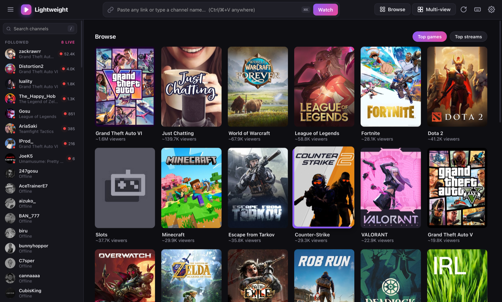

# Lightweight-Everything

**A tiny desktop app for watching Twitch, YouTube, Kick, and anything else [streamlink](https://streamlink.github.io/) supports.**
Runs on Windows and macOS (Linux works too).

Lightweight uses the webview your OS already has (WebView2 on Windows, WKWebView on macOS) through [pywebview](https://pywebview.flowrl.com/). It doesn't bundle Electron or Chromium, so the app is a few MB and doesn't need hundreds of MB of RAM just to start.

## Screenshots

| Watching a stream | Browsing categories |
|---|---|
|  |  |

---

## Features

**Watching**
- **Open any link**: paste (`Ctrl/Cmd+V` anywhere), type, or drag in a channel name, Twitch channel/VOD/clip, YouTube video/live/@channel, Kick, and more. A bare name is treated as a Twitch channel.
- **Custom player** (hls.js through a local HLS proxy): DVR seek with a **Go live** button, quality and speed selection, theatre mode, fullscreen, Picture-in-Picture
- **Twitch ad filtering**: ad segments are stripped in the proxy
- **VOD resume**: continues from where you stopped
- **Multiview**: watch 2–4 streams in a grid, pick which one has audio
- **Open in VLC / mpv / IINA**: hands the stream to an external player

**Following & discovery**
- **Sidebar**: followed channels (live first, with viewers and category) and recently watched, refreshed automatically
- **Channel pages**: profile, past broadcasts, highlights, uploads and clips
- **Browse Twitch**: top categories and live streams (needs Twitch API keys, see below)
- **Import follows** from your Twitch "Following" page with `tools/import_follows.py`

**Chat**
- Read-only Twitch chat with 7TV / BTTV / FFZ emotes and badges
- Keyword highlights, bot filter, and a pop-out chat window

**Saving**
- **Clip**: save the last 15/30/60/120 seconds of what you're watching
- **Record to disk**: saves to `~/Videos/Lightweight` (`~/Movies/Lightweight` on macOS)

### Keyboard shortcuts

| Key | Action |
|---|---|
| `Space` / `K` | Play / pause |
| `←` / `→` | Seek back / forward 10 s |
| `J` / `L` | Seek back / forward 10 s |
| `F` | Fullscreen |
| `M` | Mute |
| `T` | Theatre mode |
| `C` | Toggle chat |
| `X` | Clip the last N seconds |
| `/` | Search channels |
| `1`–`4` | Multiview: switch audio to tile |
| `?` | Show shortcuts |
| `Ctrl/Cmd + K` | Command palette |
| `Ctrl/Cmd + V` | Paste a link and play it |

## Supported sites

Twitch (live, VODs, clips), YouTube (live and VOD, using yt-dlp as a fallback), Kick, and [every site streamlink has a plugin for](https://streamlink.github.io/plugins.html).

## Requirements

- **Python 3.9+**
- **Windows**: the [WebView2 runtime](https://developer.microsoft.com/microsoft-edge/webview2/). It comes preinstalled on Windows 10 and 11.
- **macOS**: nothing extra
- **Optional**: [VLC](https://www.videolan.org/) or [mpv](https://mpv.io/) for the "Open in VLC" button

## Install & run

**Windows (PowerShell)**
```powershell
git clone https://github.com/Akpoikar/Lightweight-Everything.git Lightweight; cd Lightweight
py -3 -m venv .venv
.\.venv\Scripts\Activate.ps1
pip install -r requirements.txt
python app.py
```
> If PowerShell refuses to run the activate script, run `Set-ExecutionPolicy -Scope CurrentUser RemoteSigned` first.

**macOS (zsh)**
```zsh
git clone https://github.com/Akpoikar/Lightweight-Everything.git Lightweight && cd Lightweight
python3 -m venv .venv
source .venv/bin/activate
pip install -r requirements.txt
python app.py
```

## How to use

1. Start the app with `python app.py`.
2. Paste a link or type a channel name in the top bar and press Enter. The stream starts at the best quality; change it from the gear menu in the player.
3. Click the heart on a channel to **follow** it. Followed channels appear in the sidebar and on the home screen, and their live status updates every few minutes.
4. Click a channel name to open its **channel page** with past broadcasts and clips.
5. Use the player buttons to **clip**, **record**, open **multiview**, or open the stream in VLC/mpv.
6. Press `Ctrl/Cmd + K` for the command palette, or `?` to see all shortcuts.

### Twitch API keys (optional)

Browsing categories and faster live checks use the official Twitch API. Everything else works without it.

1. Create an app at <https://dev.twitch.tv/console> (Client Type: Confidential).
2. Copy `.env.example` to `.env` (next to `app.py`, or in `~/.lightweight/`) and fill in `TWITCH_CLIENT_ID` and `TWITCH_CLIENT_SECRET`.

`.env` is git-ignored, so your keys stay local.

### Import your Twitch follows

Copy the list from twitch.tv's "Following" page (or write one name per line) into a text file, then:

```zsh
python tools/import_follows.py follows.txt
```

## Building a standalone app

The build scripts create `.venv` if it doesn't exist, install `requirements-dev.txt`, and run PyInstaller. The finished app goes to `dist/`.

```zsh
./build/build.sh            # macOS / Linux → dist/Lightweight.app (macOS)
```
```powershell
.\build\build.ps1           # Windows → dist\Lightweight\Lightweight.exe
```

PyInstaller's temporary files go to `.pyi-build/`, which is git-ignored.

## Where your data lives

History, follows, VOD positions and settings are all stored in one JSON file:

```
~/.lightweight/data.json        (Windows: %USERPROFILE%\.lightweight\data.json)
```

To reset the app, delete that file.

## Troubleshooting

| Problem | Fix |
|---|---|
| **Ads on Twitch** | Ad segments are removed using streamlink's own Twitch ad detection (same as streamlink → VLC). During an ad break you may see a short pause instead of the ad. |
| **"No playable streams" / nothing plays** | The channel is probably offline. Follow it and the sidebar will show when it goes live. |
| **macOS: "app can't be opened" (Gatekeeper)** | The build isn't signed. Right-click the app → **Open**, or run `xattr -dr com.apple.quarantine dist/Lightweight.app`. |
| **macOS: `NotOpenSSLWarning` / LibreSSL warning** | Apple's system Python is linked against LibreSSL. Install Python from [python.org](https://www.python.org/downloads/) or Homebrew (`brew install python`) and create the venv again. |
| **Windows: blank window** | Install or repair the WebView2 runtime. |
| **"Open in VLC" does nothing** | Install VLC, or set `player_path` in settings to your VLC/mpv executable. |

## Project structure

```
Lightweight/
├── app.py               # entry point: pywebview window + JS API
├── backend/
│   ├── resolver.py      # streamlink / yt-dlp URL resolution
│   ├── proxy.py         # local HLS proxy (127.0.0.1, rewrites m3u8)
│   ├── store.py         # ~/.lightweight/data.json
│   ├── recorder.py      # record streams to disk
│   ├── live.py          # background live-status checker
│   ├── browse.py        # Twitch Helix API (browse, live status)
│   └── features/        # plug-ins: chat, multiview, clip, channel
├── ui/
│   ├── index.html, style.css, app.js
│   ├── features/        # UI for each plug-in
│   └── vendor/hls.min.js
├── tools/
│   └── import_follows.py
├── build/
│   ├── build.sh         # macOS / Linux build
│   └── build.ps1        # Windows build
├── requirements.txt
└── requirements-dev.txt # + PyInstaller
```

## Ideas / roadmap

Features that streamlink and yt-dlp would make possible:

- **Go-live notifications** for followed channels (native OS notifications)
- **Audio-only mode** for podcasts and music streams, using little bandwidth
- **Schedule recording**: start recording automatically when a follow goes live
- **YouTube / Twitch search** via yt-dlp
- **Subtitles / captions** for YouTube VODs
- **Chapters and VOD timestamps** shown on the seek bar
- **Low-latency tuning** and buffer controls per site
- **Download VODs** in the background with yt-dlp
- **Tray icon / mini player** that stays on top
