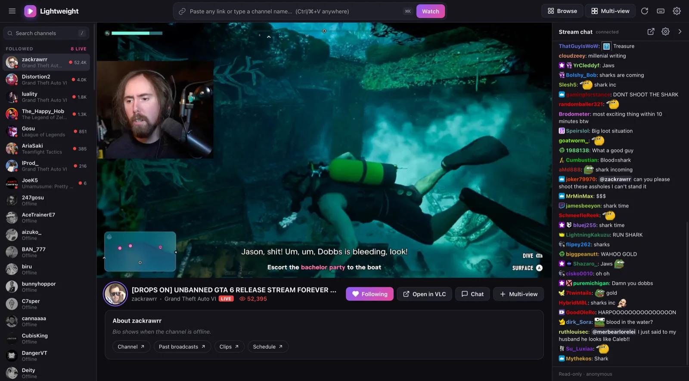
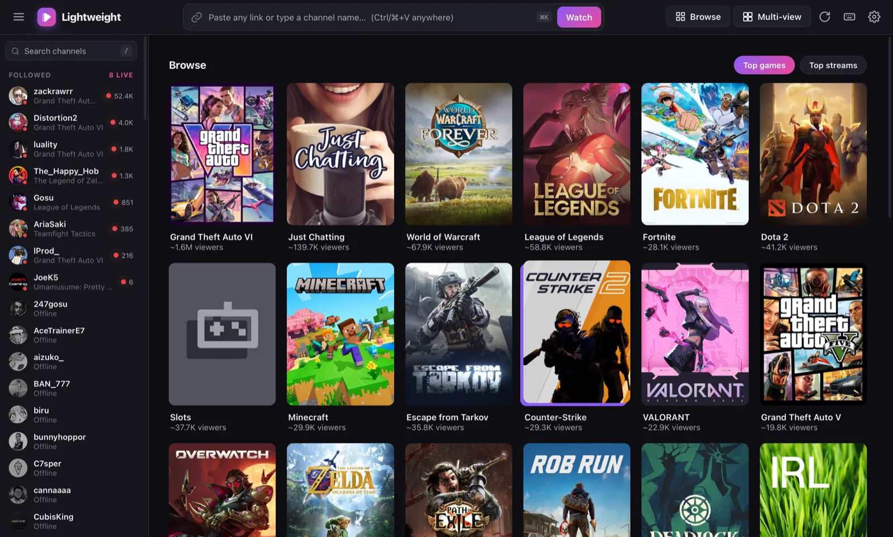

# FeatherWatch

**A tiny desktop app for watching Twitch, YouTube, Kick, and anything else [streamlink](https://streamlink.github.io/) supports.**
Runs on Windows and macOS (Linux works too).

FeatherWatch uses the webview your OS already has (WebView2 on Windows, WKWebView on macOS) through [pywebview](https://pywebview.flowrl.com/). It doesn't bundle Electron or Chromium, so the app is a few MB and doesn't need hundreds of MB of RAM just to start.

## Screenshots

**Watching a stream with chat**



**Browsing Twitch categories**



---

## Features at a glance

| Area | What you get |
|---|---|
| **Watching** | Paste any link, custom player with rewind on live streams, Twitch ad skipping, resume VODs, multi-view (up to 4 streams), open in VLC/mpv |
| **Following** | Sidebar of your channels with icons, live status and viewer counts, sidebar search, channel pages with past broadcasts and clips, Browse Twitch |
| **Chat** | Twitch chat with 7TV / BTTV / FFZ emotes, badges, keyword highlights, bot filter, pop-out window |
| **Saving** | Record streams, clip the last 15 s–2 min, trim and export clips (mp4 / gif / m4a) |
| **Stats** | How much you watch, what, and when |
| **Appearance** | 6 themes, accent colour, layout options |
| **Updates** | Keeps streamlink and yt-dlp current from inside the app |

## Feature guide

### Opening something to watch
Type a channel name (e.g. `zackrawrr`) or paste any link into the top bar and press **Enter**. You can also press `Ctrl/Cmd+V` anywhere in the window, or drag a link onto it. A bare name is treated as a Twitch channel. Works with Twitch channels, past broadcasts (VODs) and clips, YouTube videos, live streams and `@channel/live` pages, Kick, and [anything streamlink supports](https://streamlink.github.io/plugins.html).

### The player
- **Live rewind (DVR):** drag the seek bar back to rewatch something on a live stream; the **LIVE** button jumps back to the live edge. The number next to it shows how far behind live you are.
- **Quality and speed:** the sliders icon picks quality; speed (0.5×–2×) is available on VODs and videos.
- **Theatre mode** (`T`), **fullscreen** (`F`), **Picture-in-Picture** (`P`, floats the video over other apps), **mute** (`M`).
- **Resume:** VODs and videos remember where you stopped and continue from there (shown in *Continue watching* on Home).
- **Twitch ad skipping:** FeatherWatch removes Twitch's ad segments using streamlink's own ad detection, the same way `streamlink` does for VLC. During an ad break you see a short pause instead of the ad.
- **Open in VLC / mpv / IINA:** hands the stream to an external player (the button under the player). Set a custom player path in **Settings** if it isn't found.

### Multi-view (up to 4 streams)
Click **Multi-view** in the top bar, then add streams by typing a name, clicking a live channel in the picker, **dragging a channel from the sidebar** onto the grid, right-clicking a sidebar channel → *Add to multi-view*, or **+ Multi-view** under the player.
- Only one tile plays sound. Click a tile (or press `1`–`4`) to switch audio.
- Hover a tile to change its quality, make it the big tile, fullscreen it, open it in the main player or remove it.
- Layouts: Auto, 1, 2 side by side, 1 big + 2, 2×2. Your last set of streams is remembered.

### Sidebar: followed channels
- **Follow** a channel with the heart button under the player or on its channel page. Live channels go to the top, sorted by viewers, with a red dot, the game and the viewer count. Offline channels are greyed out.
- **Click a row** to watch. **Click the round icon** to open the channel page instead. **Right-click** for more (watch, unfollow, copy link, add to multi-view).
- **Recently watched** is listed below, with progress bars for VODs. Hover → ✕ to remove.
- **Search:** press `/` (or click the box at the top) and type to filter by name, title or game. **Enter** opens the first match; if nothing matches you can open what you typed as a channel.
- Live status refreshes every few minutes (change the interval in Settings), or press the refresh button in the top bar.

### Channel pages
Click a streamer's **icon or name** anywhere (sidebar, under the player, on cards). You get a banner, their icon (with a ring when live), bio, links, a Follow button and tabs:
- **Home:** live preview (if live), About, recent broadcasts.
- **Videos:** past broadcasts, highlights and uploads. Click one to watch it in the app; it remembers your position.
- **Clips** and **About**.

### Browse Twitch *(needs [Twitch API keys](#twitch-api-keys-optional-recommended))*
Click **Browse** in the top bar for top categories and live streams. Search for any channel or game, filter by **language**, sort by most viewers, recently started, or *hidden gems* (smallest streams first). Cards show channel icons and how long each stream has been live.

### Chat
Shows to the right of the player for Twitch channels (`C` toggles it). It's read-only (you can't send messages).
- Emotes from Twitch, **7TV, BTTV and FFZ** are shown as images; badges for mods, VIPs, subs and the broadcaster.
- Click the **gear** in the chat header for: **highlight keywords** (messages containing them are tinted, optional sound), **hide bots** (Nightbot, StreamElements…, list editable), timestamps, font size, and turning third-party emotes on or off.
- Scroll up to pause the chat; a *More messages below* button takes you back.
- The **pop-out** button opens chat in its own small window that stays on top of other apps.

### Recording
Press the **red dot** in the player controls to record the stream to a file; press it again to stop. Recordings go to `~/Movies/FeatherWatch` (macOS) or `~/Videos/FeatherWatch` (Windows), changeable in Settings. Recordings are also listed on Home.

### Clips and the clip editor
- Press `X` (or the **scissors** button) to save the last moments you watched. The scissors menu lets you pick 15 s, 30 s, 1 min or 2 min; `X` uses your last choice. The clip ends at what's on screen, even if you rewound.
- The "Clip saved" message has **Show in folder** and **Edit**.
- **Clip editor:** drag the start/end handles on the timeline (or press `I` / `O` at the playhead), preview with loop, name the file and export:
  - **MP4 fast** (instant, cuts on keyframes) or **MP4 precise** (re-encodes, exact cut)
  - **GIF** (480 px, 15 fps, up to 60 s)
  - **Audio only** (m4a)
- **Clips library:** *Clips* next to Recordings on Home, or *Clips library…* in the scissors menu, lists all your clips with thumbnails.
- Trimming and exporting need **ffmpeg** (see [Requirements](#requirements)). Saving clips works without it (as `.ts` files).

### Watch-time stats
Click **Stats** in the top bar (or type "stats" in `Ctrl/Cmd+K`). Only time when video is actually playing counts (including the multi-view tile with sound). Pick 7 days, 30 days, 1 year or all time to see:
- total hours, day streak, average per day, top channel
- a daily chart, your top channels and games, a heatmap of when you watch (day × hour), and your most rewatched VODs
- **Export CSV** saves everything to your Downloads folder.

### Appearance
**Settings** (gear icon) → **Appearance**. Changes preview instantly.
- Themes: **Midnight** (default), **Light**, **OLED black**, **Nord**, **Warm sepia**, **High contrast**
- Accent colour: presets or any custom colour
- Layout: font size, sidebar width, compact sidebar, card size, corner roundness, hide offline channels, reduce animations

### Updates
Twitch and YouTube change often, and old versions of streamlink / yt-dlp stop working. **Settings → Updates** shows the installed and latest versions:
- FeatherWatch checks once a day and (by default) installs new versions automatically; then click **Restart app**.
- **Check now** / **Update now** do it on demand. Turn off auto-install to only get notified.
- Works in the standalone app too: updates are downloaded from PyPI, verified, and loaded on next start. If an update ever fails to load, FeatherWatch falls back to the built-in version automatically.

### Command palette and shortcuts
`Ctrl/Cmd+K` opens a search over your channels and history. Type a link to open it, "stats" for stats, or "theme" to switch themes. Press `?` to see all shortcuts.

| Key | Action |
|---|---|
| `Space` / `K` | Play / pause |
| `←` / `→`, `J` / `L` | Seek back / forward 10 s |
| `↑` / `↓` | Volume up / down |
| `F` | Fullscreen |
| `M` | Mute |
| `T` | Theatre mode |
| `C` | Toggle chat |
| `P` | Picture-in-Picture |
| `X` | Clip the last N seconds |
| `/` | Search channels in the sidebar |
| `1`–`4` | Multi-view: switch audio to tile |
| `Esc` | Close dialog / leave theatre |
| `?` | Show shortcuts |
| `Ctrl/Cmd + K` | Command palette |
| `Ctrl/Cmd + V` | Paste a link and play it |

Clip editor: `I` / `O` set in/out, `Space` play, `←` / `→` step (`Shift` = 1 s), `Home` / `End` jump to in/out.

## Supported sites

Twitch (live, VODs, clips), YouTube (live and VOD, using yt-dlp as a fallback), Kick, and [every site streamlink has a plugin for](https://streamlink.github.io/plugins.html).

## Requirements

- **Python 3.10+** (developed on 3.14). macOS's system Python 3.9 is too old for current yt-dlp; use Homebrew (`brew install python`) or [python.org](https://www.python.org/downloads/).
- **Windows**: the [WebView2 runtime](https://developer.microsoft.com/microsoft-edge/webview2/) (preinstalled on Windows 10/11). **macOS**: nothing extra.
- **Optional**
  - [VLC](https://www.videolan.org/) or [mpv](https://mpv.io/) for "Open in VLC/mpv"
  - **ffmpeg** for clip editor export and mp4 remux: `brew install ffmpeg` / `winget install Gyan.FFmpeg`
  - **deno**, the JS runtime yt-dlp uses for full YouTube format support: `brew install deno` / `winget install DenoLand.Deno` (the `yt-dlp-ejs` package from `requirements.txt` provides the scripts it runs)

On macOS, FeatherWatch also looks in `/opt/homebrew/bin` and `/usr/local/bin`, so Homebrew's ffmpeg and deno are found even when the app is opened from Finder.

## Twitch API keys (optional, recommended)

| With keys | Without keys |
|---|---|
| Viewer counts in the sidebar, fast live checks (all follows in one request), Browse (categories, search, filters), channel banners, channel videos & clips via the official API | Playing anything, chat, following with live status (checked one by one via streamlink, no viewer counts), channel pages and VODs (via yt-dlp), recording, clips, stats, themes |

1. Go to <https://dev.twitch.tv/console> → **Register Your Application**.
2. OAuth Redirect URL: `http://localhost` · Category: **Application Integration** · Client Type: **Confidential**.
3. Copy the Client ID and create a Client Secret.
4. Copy `.env.example` to `.env` **next to `app.py`** or to **`~/.featherwatch/.env`**, and fill in:
   ```
   TWITCH_CLIENT_ID=...
   TWITCH_CLIENT_SECRET=...
   ```
Real environment variables override `.env`. `.env` is git-ignored.

## Install & run

**macOS (zsh)**
```zsh
git clone https://github.com/Akpoikar/FeatherWatch.git FeatherWatch && cd FeatherWatch
python3 -m venv .venv          # Homebrew/python.org Python 3.10+
source .venv/bin/activate
pip install -r requirements.txt
python app.py
```

**Windows (PowerShell)**
```powershell
git clone https://github.com/Akpoikar/FeatherWatch.git FeatherWatch; cd FeatherWatch
py -3 -m venv .venv
.\.venv\Scripts\Activate.ps1
pip install -r requirements.txt
python app.py
```
> If PowerShell refuses to run the activate script: `Set-ExecutionPolicy -Scope CurrentUser RemoteSigned`.

**Usage**: paste a link or type a channel name and press Enter. Click the heart to follow. `Ctrl/Cmd + K` opens the command palette, `?` lists shortcuts.

### Import your Twitch follows

Copy the list from twitch.tv's "Following" page (or one name per line) into a text file, then:
```zsh
python tools/import_follows.py follows.txt
```

## Building a standalone app

Build on each OS (PyInstaller can't cross-compile). The scripts create `.venv` if needed, install `requirements-dev.txt` (adds PyInstaller) and build from `build/featherwatch.spec` (temp files in `.pyi-build/`).

| OS | Command (from the project folder) | Output |
|---|---|---|
| macOS | `./build/build.sh` | `dist/FeatherWatch.app` + `dist/FeatherWatch-mac.zip` |
| macOS (optional) | `./build/make_dmg.sh` | `dist/FeatherWatch.dmg` |
| Windows | `powershell -ExecutionPolicy Bypass -File build\build.ps1` | `dist\FeatherWatch\FeatherWatch.exe` + `dist\FeatherWatch-win.zip` |

Move `FeatherWatch.app` to Applications, or on Windows keep the whole `FeatherWatch` folder together and make a shortcut to `FeatherWatch.exe`. The built app still uses ffmpeg, deno and VLC from your system if installed, and reads API keys from `~/.featherwatch/.env`.

The builds are unsigned: on macOS, right-click the app → **Open** the first time (Gatekeeper); on Windows, SmartScreen → **More info → Run anyway**.

## Where your data lives

| What | Where |
|---|---|
| Follows, history, VOD positions, settings | `~/.featherwatch/data.json` |
| Watch-time stats | `~/.featherwatch/stats.json` |
| Emote/avatar/clip-editor cache | `~/.featherwatch/cache/` |
| Window size/position | `~/.featherwatch/window.json` |
| Optional API keys | `~/.featherwatch/.env` |
| Recordings & clips (changeable in Settings) | `~/Movies/FeatherWatch` (macOS), `~/Videos/FeatherWatch` (Windows/Linux) |

On Windows `~` is `%USERPROFILE%`. An old `~/.lightweight` folder (FeatherWatch was formerly called Lightweight) is migrated automatically. To reset, delete `~/.featherwatch`.

## Troubleshooting

| Problem | Fix |
|---|---|
| **Short pause on Twitch** | Ad segments are dropped (same detection as streamlink), so an ad break shows as a brief pause instead of the ad. |
| **YouTube fails / formats missing** | yt-dlp is out of date: **Settings → Updates** → update, then restart. Install deno and make sure `yt-dlp-ejs` is installed (`pip install -r requirements.txt`). |
| **"No playable streams" / nothing plays** | The channel is probably offline. Follow it and the sidebar shows when it goes live. |
| **Clip export / trim disabled** | ffmpeg is not installed or not on PATH (see Requirements). |
| **Windows: blank window** | Install or repair the WebView2 runtime. |
| **macOS: "app can't be opened"** | Unsigned build: right-click → **Open**, or `xattr -dr com.apple.quarantine dist/FeatherWatch.app`. |
| **macOS: LibreSSL / `NotOpenSSLWarning`, yt-dlp errors** | You're on Apple's Python 3.9. Recreate the venv with Homebrew/python.org Python. |
| **"Open in VLC" does nothing** | Install VLC, or set the player path in Settings. |

## Project structure

```
FeatherWatch/
├── app.py                # entry point: pywebview window + JS API
├── backend/
│   ├── resolver.py       # streamlink / yt-dlp URL resolution
│   ├── proxy.py          # local HLS proxy (127.0.0.1), Twitch ad filtering
│   ├── store.py          # ~/.featherwatch/data.json
│   ├── recorder.py       # record streams to disk
│   ├── live.py           # background live-status checker
│   ├── browse.py         # Twitch Helix API + .env loading
│   ├── profile.py        # channel profiles
│   └── features/         # chat, clip, clipedit, channel, browseplus, stats, theme, ...
├── ui/
│   ├── index.html, style.css, app.js
│   ├── features/         # UI per feature (chat, multiview, clip, stats, theme, updater, ...)
│   └── vendor/           # hls.js
├── tools/import_follows.py
├── updater_boot.py       # loads updated streamlink/yt-dlp in the standalone app
├── build/                # featherwatch.spec, build.sh, build.ps1, make_dmg.sh, icons/
├── docs/screenshots/
├── requirements.txt
└── requirements-dev.txt  # + PyInstaller
```

## Roadmap

- Go-live notifications for followed channels
- Auto-record when a channel goes live
- Mini player / always-on-top window
- Tray icon
- Audio-only mode
- Pinned / grouped follows
